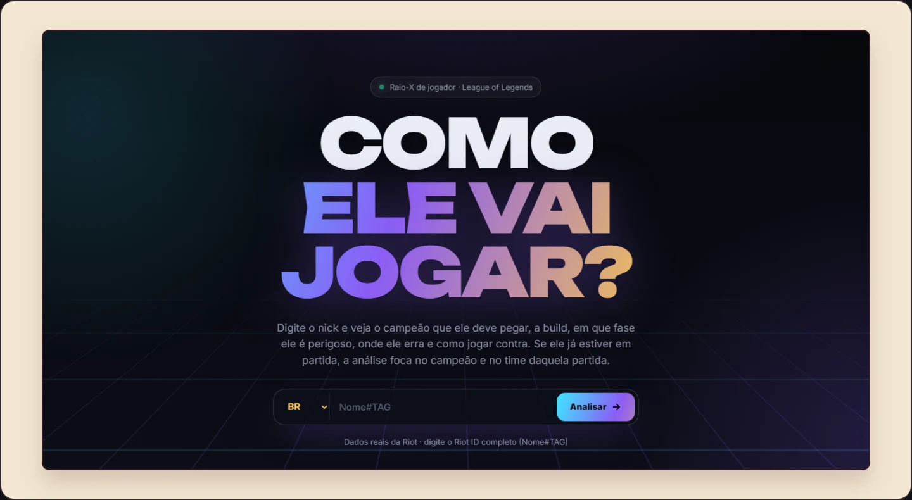
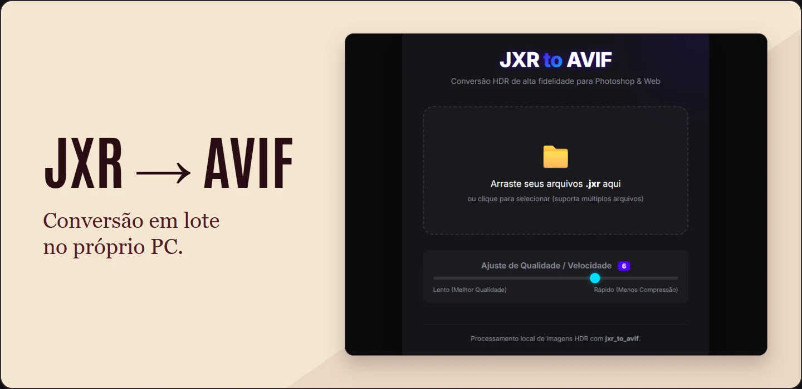
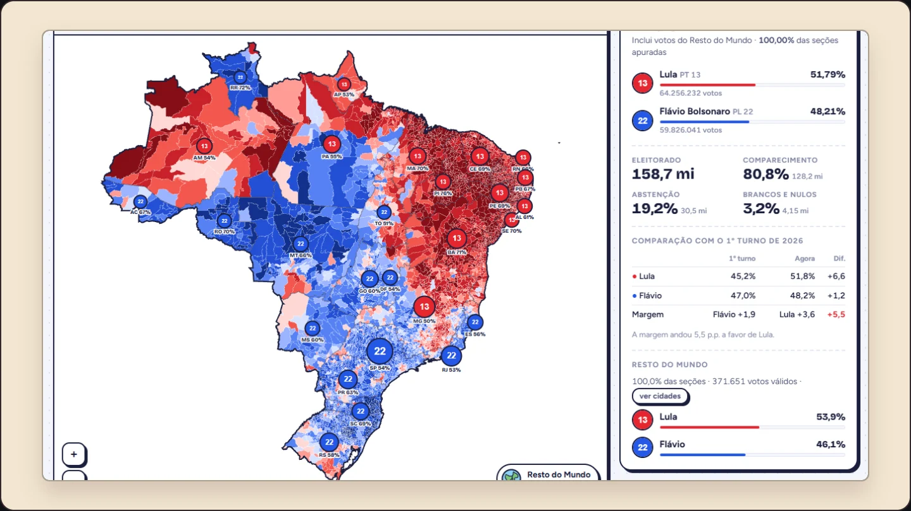
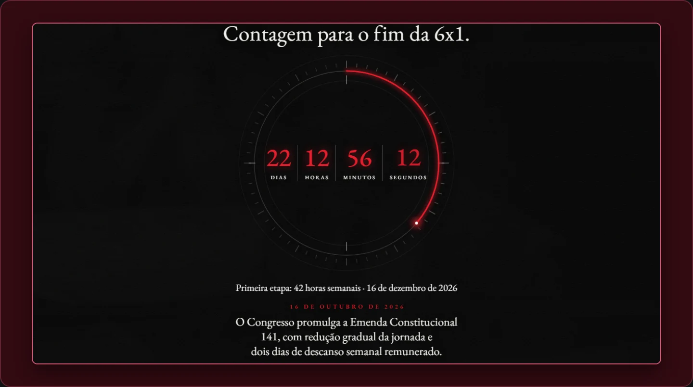
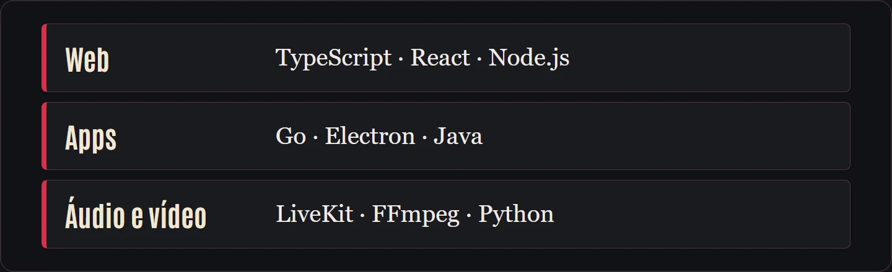

Sou o Binhoc, editor de vídeo e “programador” vibecoder. <strong>Só programo junto com IA.</strong>

Faço apps para jogar com os amigos e ferramentas para o trabalho com vídeo.

<a href="#projetos"><strong>Ver projetos</strong></a> · <a href="#tecnologias">Tecnologias</a>

## Projetos

### Friendo Voice

Uma sala para conversar, jogar e assistir à tela dos amigos.

  <a href="https://friendo.137-131-179-91.sslip.io/desktop2/video/principal-1080p.mp4">
    <picture>
      <source media="(prefers-reduced-motion: reduce)" srcset="assets/friendo-voice.webp">
      
    </picture>
  </a>

Criei o Friendo para juntar minha turma em chamadas de voz e vídeo, com chat, compartilhamento de tela e perfis personalizáveis. Dá para transmitir pelo app de Windows e acompanhar as chamadas pelo Android.

[Conheça o Friendo Voice](https://friendo.137-131-179-91.sslip.io/) · [Vídeo completo](https://friendo.137-131-179-91.sslip.io/desktop2/video/principal-1080p.mp4) · [Detalhes técnicos](projetos/friendo-voice.md) 
Web, Windows e Android · TypeScript, Go, Java e LiveKit · Código privado

### DuoScope

Um raio-X do jeito de jogar no League of Legends.

Busque um Riot ID para ver histórico, campeões mais usados e desempenho por rota. O aplicativo complementar para Windows acompanha a seleção de campeões. O site abre em modo de demonstração, com dados simulados.

[Abrir o site do DuoScope](https://duoscope.duckdns.org/) · [Detalhes técnicos](projetos/duoscope.md) 
Web e Windows · JavaScript, Node.js e Electron · Código privado

### Aether Media

Uma galeria para encontrar replays e capturas espalhados pelo PC.

Escolha as pastas que quer indexar. A galeria agrupa os arquivos por jogo e abre imagens e vídeos no próprio navegador.

[Código e instalação](https://github.com/creachec/aether-media) 
Next.js, TypeScript e FFmpeg

### Conversor HDR

De capturas JXR para AVIF HDR no próprio PC.

Selecione um lote de capturas e baixe os arquivos convertidos individualmente ou em um ZIP.

[Código e instalação](https://github.com/creachec/conversor-hdr) 
Node.js e Express

### Mapa da Apuração

A eleição presidencial de 2026, município por município.

Explore o resultado final por município e estado e compare com o primeiro turno e com 2022. A visualização usa dados oficiais do TSE.

[Abrir o mapa](https://creachec.github.io/mapa-apuracao/) · [Código](https://github.com/creachec/mapa-apuracao) 
JavaScript e D3

### Contagem do Fim da 6x1

Um relógio para acompanhar a transição da jornada de trabalho.

O contador acompanha as etapas previstas na Emenda Constitucional 141 e apresenta uma linha do tempo dos direitos trabalhistas no Brasil.

[Abrir o site](https://creachec.github.io/fim-da-6x1/) · [Código](https://github.com/creachec/fim-da-6x1) 
HTML, CSS e JavaScript

### SD Organizer

Do cartão da câmera à pasta do evento.

Importa as gravações, organiza arquivos por evento, dia e tipo de mídia e prepara o envio ao Drive. A edição pública começa com um evento de exemplo que você pode editar.

[Código e instalação](https://github.com/creachec/sd-organizer) 
Electron e rclone

<strong>Mais projetos</strong>

- [Stremio Kai Timeworn](https://github.com/creachec/Stremio-Kai-Timeworn) · Adaptação comunitária do Stremio Kai para TVs LG com webOS 3.x.
- [FIFA Squad Auction](https://github.com/creachec/fifa-squad-auction) · Leilão de jogadores para montar elencos com os amigos.
- [Video Creation Hub](https://github.com/creachec/video-creation-hub) · Painel web para organizar a produção de vídeo.
- **Friendo Remote** · Transmite a tela e o áudio do PC para uma TV LG pela rede local.
- **Gaming Gallery Launcher** · Biblioteca de jogos de PC com navegação por controle.

## Tecnologias

---

O Karpathy falou em “forget that the code even exists”. Aqui eu esqueço. O terminal faz questão de me lembrar. [Post original](https://x.com/karpathy/status/1886192184808149383)
