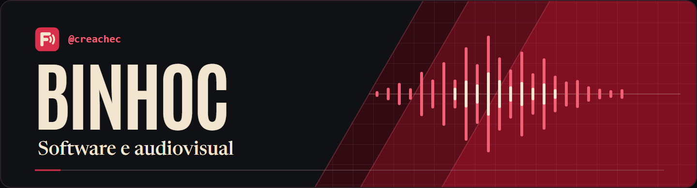
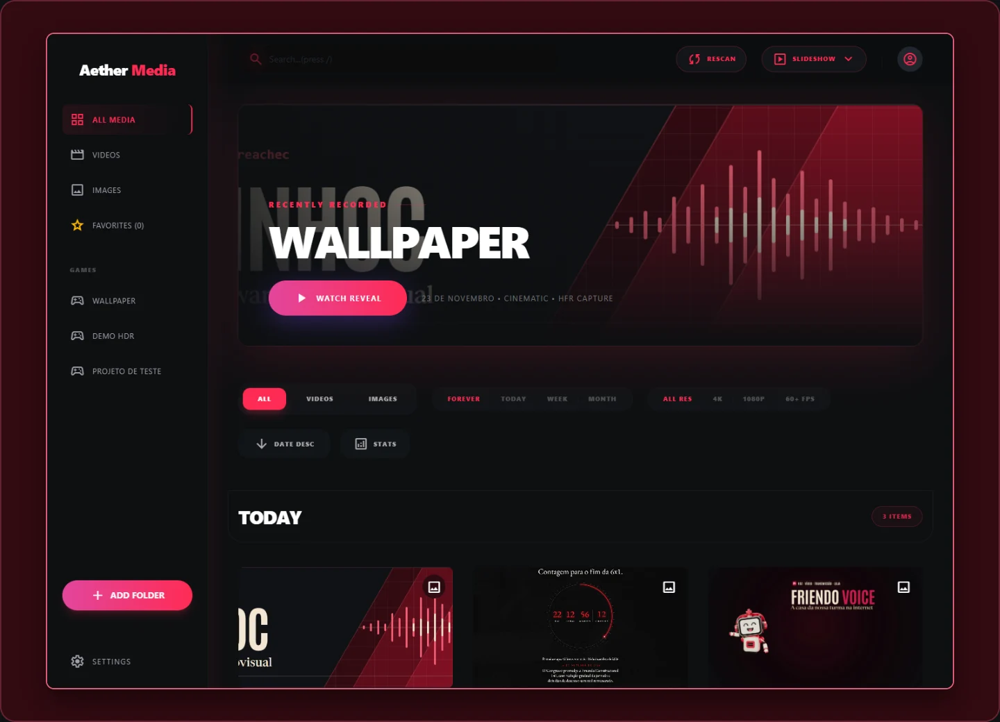

Sou o Binhoc, editor de vídeo e “programador” vibecoder. **Só programo junto com IA.** Eu trago a ideia, guio a implementação e testo no meu dia a dia. Faço apps para jogar com os amigos e ferramentas que me poupam trabalho na edição.

[Destaques](#projetos-em-destaque) · [Projetos públicos](#projetos-públicos) · [Tecnologias](#tecnologias)

## Projetos em destaque

### Friendo Voice

**Uma sala para conversar, jogar e assistir à tela dos amigos.**

O Friendo reúne chat, voz, vídeo, transmissão de tela e perfis personalizáveis. No Windows, a captura roda no app nativo. No Android, dá para acompanhar o chat e entrar nas chamadas.

[Conheça o Friendo Voice](https://friendo.137-131-179-91.sslip.io/) · [Assistir ao vídeo principal](https://friendo.137-131-179-91.sslip.io/desktop2/video/principal-1080p.mp4) · [Detalhes técnicos](projetos/friendo-voice.md)

**Web, Windows e Android** · TypeScript, Go, Java, WebView2 e LiveKit · Código privado

### DuoScope

**Um raio-X do jeito de jogar no League of Legends.**

A busca por Riot ID reúne histórico, campeões mais usados, desempenho por rota e comparações entre jogadores. Um companion para Windows acompanha a seleção de campeões. A demonstração usa dados simulados.

[Abrir o site do DuoScope](https://duoscope.duckdns.org/) · [Detalhes técnicos](projetos/duoscope.md)

**Web e Windows** · JavaScript, Node.js e Electron · Código privado

## Projetos públicos

### Aether Media

Uma galeria local para encontrar, organizar e assistir replays e capturas. Ela indexa as pastas que eu escolho e agrupa os arquivos por jogo.

[Código e instalação](https://github.com/creachec/aether-media) · Next.js, TypeScript e FFmpeg

### Conversor HDR

Converte capturas JXR em AVIF HDR no próprio computador. Aceita um lote e reúne os arquivos prontos num ZIP.

[Código e instalação](https://github.com/creachec/conversor-hdr) · Node.js e Express

### Mapa da Apuração

Explore o resultado final da eleição presidencial de 2026 por município e estado, com comparações com o primeiro turno e 2022.

[Abrir o mapa](https://creachec.github.io/mapa-apuracao/) · [Código](https://github.com/creachec/mapa-apuracao) · JavaScript, D3 e dados do TSE

### Contagem do Fim da 6x1

Contagem para as etapas de redução da jornada previstas na Emenda Constitucional 141, com uma linha do tempo dos direitos trabalhistas no Brasil.

[Abrir o site](https://creachec.github.io/fim-da-6x1/) · [Código](https://github.com/creachec/fim-da-6x1) · HTML, CSS e JavaScript

### SD Organizer

Importa cartões de câmera, organiza arquivos por evento e prepara o envio ao Drive. A edição pública começa com um evento de exemplo que dá para personalizar.

[Código e instalação](https://github.com/creachec/sd-organizer) · Electron e rclone

Outros projetos

- [Stremio Kai Timeworn](https://github.com/creachec/Stremio-Kai-Timeworn) · Adaptação comunitária do Stremio Kai para TVs LG com webOS 3.x.
- [FIFA Squad Auction](https://github.com/creachec/fifa-squad-auction) · Leilão de jogadores para montar elencos, acompanhar lances e fechar os times.
- [Video Creation Hub](https://github.com/creachec/video-creation-hub) · Painel web para organizar a produção de vídeo.
- **Friendo Remote** · Transmite a tela e o áudio do PC para uma TV LG pela rede local.
- **Gaming Gallery Launcher** · Biblioteca de jogos de PC com navegação por controle.

## Tecnologias

---

O Karpathy falou em “forget that the code even exists”. Aqui eu esqueço. O terminal faz questão de me lembrar. [Post original](https://x.com/karpathy/status/1886192184808149383)
